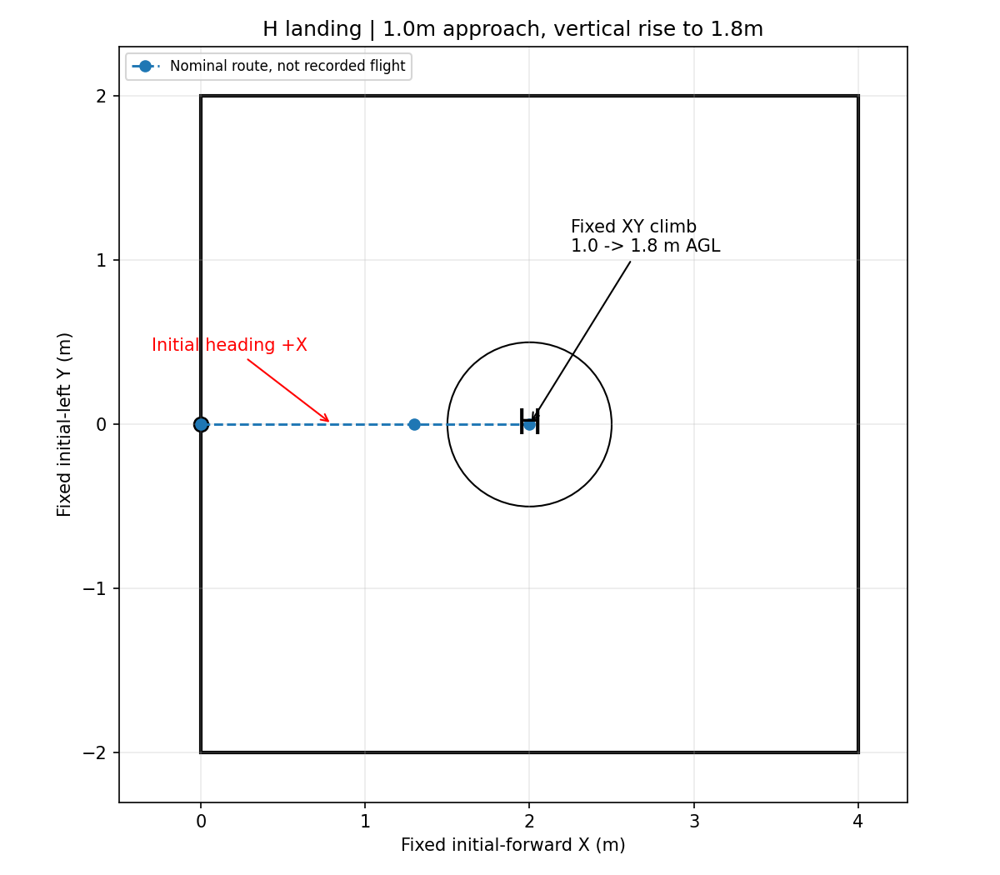

# 专项3：前方H→低空接近→定点爬升→视觉对齐→H降落

## 2026-10-14 当前入口：使用08的H降落配置

03前往H的三段导航均使用0.6m前视，参考08走廊末段/近H导航；控制器规划目标
接纳距离保持0.75m。首段阶段切换也使用0.6m，避免任务管理器重新写入1.0m后
被控制器持续拒绝、起飞点悬停并超时。08普通入口接纳0.75m，正赛速度入口
接纳1.2m；08巡航首段1.0m和近H末段0.6m均保持原配置。前视距离单位为米，非速度。

03是独立H测试任务，不执行投递或全场搜索。`start.sh`/工作台的03入口启动时，
从 `08_full_mission/settings.yaml` 读取全部 `landing_*` 策略字段（除 `landing_xy`）；
以后修改08的H设置，03下次启动会自动跟随。03的设置文件中保留当前值供查看，
启动加载时以08为准。下方旧日期的高度及模式描述属于历史记录。

当前08：`vh` 对准（≤6cm、水平速度<0.1m/s持续1s），下降模式2（冻结H的XY＋独立Z轨迹），
Z轨迹速度 **1.0m/s**；FC识别高度1.2m、下降目标0.35m；低位检查通过后切POSCTL，飞手完成落地。
速度是设定高度的变化率，不保证实测下降速度。08后续更改时应以其实际配置及检查输出为准。

03只保留自己的任务类型、航线、场地范围和H位置；H位置仍从专项现场配置的
`landing_xy` 获取，当前示例为 `[2.0, 0.0]`，需与实际摆放位置一致。
现场配置和显式CLI覆盖仍拥有原来的优先级；测试08原配置时，不添加额外的
`--landing-config`、H模式或下降速度覆盖选项。

配置检查（不启动ROS节点或飞行）：

```bash
bash deployment/board_trials_4x4/03_h_landing/start.sh preview \
  --site-config deployment/site_20260928/h_landing_test_area.yaml --check-config
```

随后仍使用本页下方03的预览/实飞入口。当前修改未部署，板端需先同步这些入口脚本与配置。

2026-10-12：新增可选 mode4/OFFBOARD，[覆盖配置与离线调用](../../competition/candidates/README.md)。用 `--landing-config deployment/competition/candidates/h_offboard_mode4.override.yaml` 叠加原实测现场配置；冻结XY＋负VZ、关闭Z位置控制，新鲜真实落地后普通disarm。默认 mode1/POSCTL 和原 low/high 选项保持；未部署、未动态验收。

> 2026-10-06：现场80×80cm H靶，FC中心离地1.0m接近、1.2m识别；必须飞手手动解锁并拨入OFFBOARD，稳定起飞后自动进入任务。H专项最终视觉对齐、下降后切POSCTL，由飞手接续下降落地，不使用普通组的30cm悬停。

2026-09-27更新：原四组已继承最新板端/研究修复；共同三维膨胀改为27.5/20/10cm，静态TF与关闭虚拟顶棚保持。最新入口见[八组说明](../MODULES.md)，[本次实跑及录像](../../../docs/verification/board_modules_20260927/REPORT.md)。本文旧日期段落只描述当时版本。

场地总面积4×4m，起飞点在近侧边中点，+X是机头前方、+Y向左。H中心放在约(2.0,0.0)，保持靶面平整且无其他类似黑圈干扰。



## 执行过程

1. 原地起飞到FC离地1.0m，启动任务后先到(1.3,0)，再到H的大致位置(2.0,0)，仍保持1.0m。
2. XY保持(2.0,0)，**单独升到1.2m**。该升高是明确的垂直航段，不依赖H先被识别，便于检验定点爬升。
3. 进入与08完整任务相同的H视觉对齐和下降流程，要求新的合法H观测、稳定对齐和高度交接；本专项随后请求POSCTL，飞手接续下降落到H上。

共同入口显式开启`/landing_detector/landing_enable_h_stroke_fallback=true`，覆盖03、04和08的LAND阶段。完整圆环及内部H校验仍优先，失败时才尝试H笔画兜底；默认预览/接近阶段保持检测关闭，进入真正LAND后再接受新帧。投影使用实际CameraInfo和图像时刻TF，保留现场相机安装外参。

末端门槛与完整任务相同：XY误差不超过8cm，累计10个新的合法H帧，观测年龄不超过0.5s；满足后锁定地图H中心，向FC离地0.40m下降，在FC离地不超过0.55m且XY仍合格时请求POSCTL。服务接受请求后冻结交接时Z设定点，看到MAVROS实际进入POSCTL才记录交接已到达。POSCTL保持位置和高度，剩余下降由飞手完成；模式请求成功不代表已经落地，任务仍以新鲜ON_GROUND与落地稳定为落地依据，专项收尾还要确认解除武装。

本专项`settings.yaml`显式设置`landing_handoff_mode: POSCTL`，控制参数为`/external_landing/handoff_mode`，默认`AUTO.LAND`；04/08保持默认自动末段。仅允许这两种模式，H对准、观测与高度门槛保持原值。03如需自动SITL末段，须显式选择`AUTO.LAND`。本轮程序请求后实际进入POSCTL属于正常交接；提前人工切换模式、切到其他模式或交接后重返OFFBOARD会取消旧LAND事务，重新拨回OFFBOARD不会自动恢复该事务。程序不发送RC override、油门或强制停桨命令。

交接时保持偏航杆中立、油门接近悬停中位；确认实际模式为POSCTL后，由飞手缓慢降低油门落地。触地后解除武装，保持POSCTL并等待工作台落地收尾，再切其他模式。任务稳定判据默认1.0s，专项收尾另要求未解锁/ON_GROUND持续3s。需要中止时仍可立即人工接管，该轮会保留取消或INCOMPLETE结果。接口身份与新鲜度约定见[交接约定](../../../docs/deployment/h_posctl_handoff_20261006/INTERFACE_PROPOSAL.md)。

前两个点只提供H附近的大致位置；最终对齐依靠CV，不把预设(2,0)当作识别成功。本套不启动释放许可/投递代理或mock服务，不执行任何投递。当前默认高度都已配好；H摆放约2m、低空1.0m、识别1.2m可在本目录`settings.yaml`集中调整，不需手动换算local Z。

## 启动

完成[公共准备](../README.md)并停止旧应用，MAVROS、driver2和标定相机先运行。

```bash
bash deployment/board_trials_4x4/03_h_landing/start.sh preview --site-config deployment/site_20260928/h_landing_test_area.yaml
# Ctrl+C退出preview后再运行：
bash deployment/board_trials_4x4/03_h_landing/start.sh flight --site-config deployment/site_20260928/h_landing_test_area.yaml
```

脚本继承公共已知外参，在未解锁静置时自动建立地面基准；飞控停地Z约0不需要人为改成地面真值。现场入口加载`deployment/site_20260928/h_landing_test_area.yaml`，看到READY后由飞手人工解锁并拨入OFFBOARD，在1.0m起飞高度稳定后自动启动任务，不需再手动调用start_mission。未加载现场配置的直接模块入口，应核对实际auto_start_after_arm参数后使用。

`preview`只看定位、地图和视觉，不飞；`flight`接通飞控输出，解锁及OFFBOARD均由飞手操作。板端默认不增加相机录像/JPEG编码。不要与其他两套或旧整机同时启动。

## 重点观察

- 在同一XY位置能否稳定从1.0m升到1.2m，是否出现坐标突然跳变或指令横向偏转。
- 进入LAND后是否取得新鲜H观测、对齐到H中心，再降低高度；正常识别爬升不应误当越限。
- 如果没有H或H不可识别，不应仅凭预设坐标宣称视觉降落成功。及时接管；失败/手动收尾保留INCOMPLETE。
- 交接日志先显示POSCTL请求已发送，再显示实际模式到达并等待飞手下降；保持偏航杆中立。此次修改尚无实飞验证，不能据模式名认定旋转问题已经解决。
- 最终判断结合相机H标记、任务LAND结果及MAVROS ON_GROUND/解除武装状态。程序不强制停桨，不自动改飞控降落参数。

每次回看入口为`logs/board_landing_<时间>/index.html`；原始/标注相机录像、地图/视觉结果和位姿均保留。原有CV模式随任务阶段切换，预览阶段未出现H对齐标记不等于已经进入LAND验收。

2026-10-06部署确认：`orangepi@192.168.43.59`的`/home/orangepi/liftrace_board_trials_20260928`已同步H笔画兜底补丁，板上新旧H入口配置检查、6项配置回归及03/04/08的板端/仿真静态展开通过；现有检测器二进制包含笔画兜底参数。本轮没有启动节点或飞行，实机H降落尚未验收。

本分支同步：默认alignment_mode=legacy_static、virtual_ceiling_enabled=false，共享自动高度精度、控制器READY及真实离地后落地收尾修复；控制Z限幅保留。


2026-09-26共同更新：继承当前板端相机方向/槽位；起飞初始前视0.25m、巡航0.50m，限速仍0.5m/s。恢复目标高于交接门槛10cm；统一三维膨胀25/20/10cm，仅第二套增加中部柱，虚拟顶棚仍关闭。[原因与验证](../../../docs/planning/obstacle_board_alignment_20260926/REPORT.md)。本轮未重新上板。

高度口径：`ground_z = 静置FC局部Z - fc_ground_clearance`，识别目标为`ground_z + 1.2`，不是固定local Z=1.2。现有静置FC离地0.22m、相机位于FC下方0.16m时，静置local Z=0对应识别local Z=0.98m，水平姿态镜头离地约1.04m。H检测按图像结构及相机/位姿投影，不通过写入0.8m靶宽推定高度；80cm真靶在该高度的完整视野与反光识别仍需现场验证。整机和走廊+H专项高度未被本次覆盖。


2026-10-06 POSCTL补丁部署确认：板端ARM控制器已重新编译链接，13个补丁文件一致，板端43项交接/配置测试及6次H配置展开通过。01–09不因本检查自动启动；当前H应用停止、未解锁，尚无此补丁实飞验收。03最终配置为POSCTL，飞手接续下降；完整版本/回滚/检查见[部署报告](../../../docs/deployment/h_posctl_handoff_20261006/DEPLOYMENT.md)。


2026-10-06 H视觉更新：已部署灰度自适应分割和H形态主判据，摆脱固定饱和度对偏色黑笔画的漏检；外圈优先、裁切笔画兜底继续启用。ARM构建、6项图形测试、464张实拍及60张构造图复跑通过，8项配置回归通过。保持本专项1.2m识别与POSCTL交接，04/08原高度与AUTO.LAND不变。参见[视觉部署报告](../../../docs/verification/h_morphology_20261006/DEPLOYMENT.md)；尚需新视觉与末段交接组合实飞。

### 2026-10-06 H成功结果推广（本地，待上板）

现场H成功由用户确认。03/04/08硬件使用形态检测及视觉对准下降，末段POSCTL交接飞手完成降落；不再按本页早期AUTO.LAND描述启动。仿真生成入口显式AUTO.LAND。各组原观察高度保持：03为FC离地1.2m，04/08为1.8m。04/08可在工作台填实测走廊/H/墙面坐标，须先配置检查再预览。参见[推广与九组参数报告](../../../docs/deployment/h_promotion_20261006/REPORT.md)。

### 2026-10-06 后续部署状态

上述H交接推广现已部署192.168.3.126原0928工程并通过配置检查，未启动新试飞。工作台已增加搜索范围自动航线与FOV图，04走廊点及08走廊/H仍需实测。详见[本次部署报告](../../../docs/deployment/survey_workbench_20261006/REPORT.md)。
