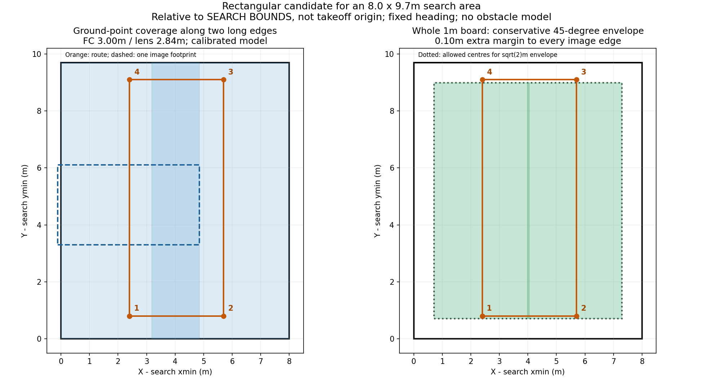
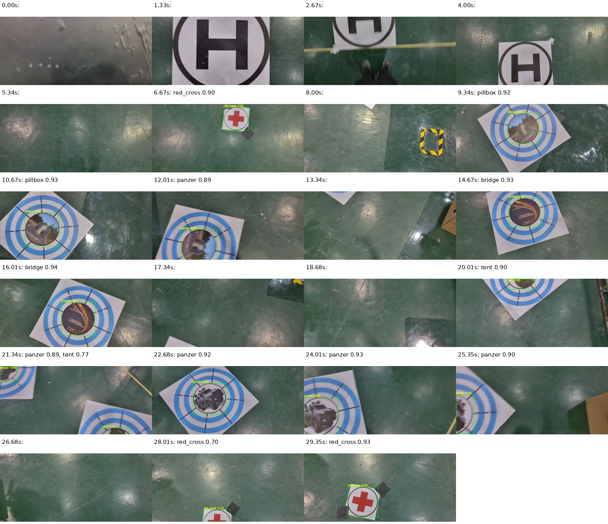
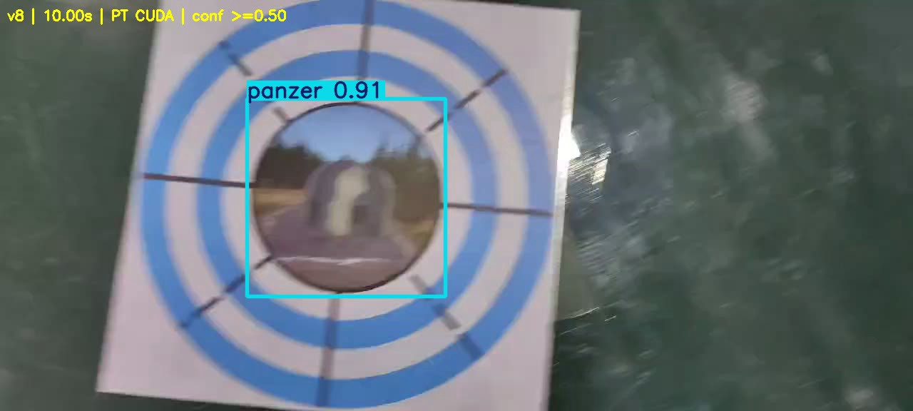
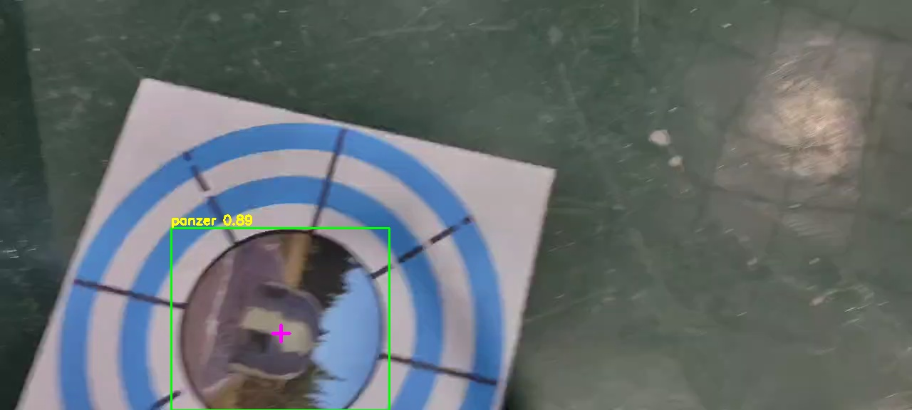

# 2026-10-15：真实场地四边形搜索与实录视频验证

本轮按用户最新偏好评估四边形。**8m（X）×9.7m（Y）搜索区推荐候选为FC AGL 3.0m、镜头AGL约2.84m，矩形长边沿Y，两个X位置约为xmin+2.4m、xmin+5.7m。**这是根据现有机载标定推算的覆盖候选，尚非新场地飞行验收。

视频的五类均出现正确识别，但仍存在高置信度地堡→装甲车误报；部分错误类别能通过现有圆环关联。因此不能据此宣布新场地识别链已完全通过。未改运行源码、模型、航线配置或板端。

## 1. 内参推算FOV与高度

来源：1014实飞CameraInfo，见[前轮FOV分析](../flight_1014_0425_20261014/BRIDGE_FOV.md)及[原始数值](../flight_1014_0425_20261014/bridge_metrics.json)。图像1280×720，fx=725.351、fy=723.340、cx=631.672、cy=397.566；D=[0.005867,0.017911,-0.001006,0.001472,-0.026485]。FC→IMU +0.05m、IMU→镜头−0.21m，净Z为−0.16m；名义水平安装时图像u对应机体−X，v对应+Y。

- 零畸变针孔FOV：任务X **82.84°**，Y **52.82°**。
- 按当前D去畸变、沿主点横纵截线计算：X **82.67°**，Y **52.71°**。
- 这是**实机标定模型的推算**，不是现场尺量的实际FOV，也不是模型必然能识别的有效区域。若采集裁切、缩放或镜头设置变化，必须重核CameraInfo。

| FC离地 | 镜头离地 | 水平针孔覆盖X×Y | 含D数值内接矩形X×Y |
| --- | --- | --- | --- |
| 2.16m | 2.00m | 3.53×1.99m | 3.50×1.97m |
| 2.60m | 2.44m | 4.31×2.43m | 4.27×2.41m |
| 2.76m | 2.60m | 4.59×2.59m | 4.55×2.57m |
| **3.00m** | **2.84m** | **5.01×2.83m** | **4.97×2.80m** |

内接矩形将针孔矩形统一缩放，并以4004个边界采样点投影检查；不是解析最大内接矩形。主点不居中，因此FC3.0m时地面范围相对相机为X约[−2.518,+2.453]m、Y约[−1.548,+1.256]m，不能机械地各除以二。

## 2. 四边形如何放

设搜索区X=[xmin,xmin+8]，Y=[ymin,ymin+9.7]，建议几何候选：

```text
1: (xmin+2.4, ymin+0.8)
2: (xmin+5.7, ymin+0.8)
3: (xmin+5.7, ymax−0.6)
4: (xmin+2.4, ymax−0.6)
回到1闭合；可选离起飞点最近的角作为起点。
```

这是内收矩形，尺寸约3.3×8.3m，闭合长度23.2m，不含起飞接入、避障绕行和投递。**这些是相对搜索边界的偏移，不是可以直接填入起飞坐标系的绝对点。**起飞点不在场地角落时，先测出其坐标系下的xmin/ymin，再逐点相加。无需改变“起飞处为自身坐标原点”的定义。



左图是地面点覆盖；右图进一步考虑完整1m板在任意平面转角下的√2m包络，并给图像每侧预留10cm。图中绿色区域是这个保守包络下可被完整看见的靶心区域。两者都假定相机水平、保持名义固定航向、平地、整块靶板在搜索区内，无障碍遮挡。

该路线在FC3.0m下，完整旋转板的附加图像边缘余量最小约**11.8cm**：左侧11.79cm，右侧15.32cm，中间接缝每侧12.85cm。这不是姿态/定位误差保证。FC2.76m时，即使优化两条长边位置，也不能在这套保守矩形模型下保证8m全宽中任意转角的整块1m靶板均完整入镜；仅轴对齐板的统一附加余量也很小。因此四边形优先评估3.0m，不能只拿点覆盖百分比判断。

这里的“任意转角”指**靶板转角**，不是飞机航向。飞机若随边转头90°，相机宽窄轴也会旋转，上述覆盖不再成立。横滚、俯仰、真实障碍及轨迹偏离另需现场确认。

配置衔接：

- 当前正赛`high_agl`校验最高3.0m，`max_agl=3.2m`；本候选处于前者上界，离后者仅0.20m。不能把软件上限直接填成搜索高度，也不能默认实际超调一定小于20cm。
- 原`candidates/rectangle_motion.yaml`仍为FC2.76m、镜头2.60m；选择rectangle并不会自动变成本文3.0m候选。
- 采用候选时，高位高度、镜头高度、搜索区、具体航点和高位证据窗口须一致。按现有±0.2m生成规则，3.0m对应2.8～3.2m窗口；它仍受软件限高约束。
- 工作台统一inset同时作用X/Y，不能直接表达上述不同内收量；可在地图编辑器分别调整。近墙、走廊及机体中心合法边界仍须按实际场地检查。
- 升高改善覆盖，也缩小目标像素：3.0m时正下方0.35m红十字约89px，缩到640输入约45px；该尺寸估算不等于高位识别通过。最好用真实下视图在候选高度确认红十字与地堡表现。

本轮没有自动改上述配置。完整数值和复现算法见[fov_metrics.json](fov_metrics.json)、[coverage.py](coverage.py)。

## 3. 视频、模型与实际运行版本

输入：`/home/xhj/liftrace/vision_ws/test_data/比赛场地实录1.mp4`，Huawei P60手机录像，1280×576，约29.986fps、903帧、30.114秒。它不是机载1280×720下视相机；**不能套用机载K和TF计算本视频地面位置**。

使用`/home/xhj/liftrace-deliverables/new_video_20261011/final/best.pt`，对应`flight_5cls_new_video_v8_20261011`。1013/1014运行metadata顶层记录已加载此模型的FP16 RKNN及同名metadata；其中嵌入的旧10月8日部署清单仍指向0928旧模型，不能用旧清单替代运行模型路径。此次核验按实际v8处理。

实际板端记录路径：

```text
/home/orangepi/liftrace_board_trials_20260928/runtime_models/flight_5cls_new_video_v8_20261011/flight_5cls_new_video_v8_20261011_fp16.rknn
/home/orangepi/liftrace_board_trials_20260928/vision_ws/src/uav_vision/config/flight_5cls_new_video_v8_20261011_metadata.yaml
```

本机推理用同源PT、CUDA FP32；640方形letterbox，conf≥0.5、classwise NMS IoU0.45、rect=false，无增强。**不是板端RKNN实跑或性能测量**。类别为bridge、panzer、pillbox、tent、red_cross；H不是YOLO类别。

## 4. 五类效果及需要重视的问题



五类均有正确识别，且均出现超过0.75的正确候选。另对21个疑似错误框逐帧及邻帧人工复核：

| 视频时间 | 实际物体→错误类别 | 错误框所在帧数 | 最高置信度 | 高于0.75的错误框 |
| --- | --- | --- | --- | --- |
| 8.704～8.771s | 地堡→panzer | 3 | 0.727 | 0 |
| 10.005～12.372s | 地堡→panzer | 15 | **0.905** | **10** |
| 21.577s | 装甲车→bridge | 1 | 0.586 | 0 |
| 25.412～25.445s | 装甲车裁切残片→red_cross | 2 | 0.522 | 0 |

15帧地堡区间中有4帧同时保留更高置信度的正确pillbox框与较低错误panzer框，不能说15帧都是最高置信类别错误。该区间也**不全是裁切**：10.005s内部地堡图案完整可辨，仍报panzer约0.905。



因此HINT=0.75可以滤去本视频若干低分错误，**滤不掉上述10个高分错误panzer框**，不能仅靠提阈值解决类别混淆。片段连续高度相关，不能将帧数当作独立试验数；没有全帧人工真值，不报告全片precision/recall/mAP。

前0～5秒H及地面区间150帧，在conf≥0.5下无YOLO框。这支持该片段H负样本表现，但不是全场无误报证明。

## 5. 生产几何、融合和精修

不仅运行YOLO，还每15帧采样（约2Hz，共61帧），提取并调用当前生产C++圆环、红十字、H几何方法；再用真实生成消息类型和生产`DetectionFusion`、`TargetRefiner`方法做内存内串接。版本为试飞feature分析前HEAD `04581130`。

- 圆环19帧有结果；红十字7帧；H 2帧（约3.001s、3.502s）。分母包含大量地面/其他类，不能称为检出率。
- H使用当前YAML默认参数（笔画兜底默认false），与现场launch覆盖并不必然完全相同；另测试landing模式过滤，留下H输出。
- 融合/精修后带几何的语义输出：pillbox5、panzer7、bridge5、tent2、red_cross7。**panzer中包含误报，不是正确数。**
- 10.005s和12.006s的错误panzer均能通过圆环关联。12.006s同JPEG像素下panzer置信度0.886、圆环质量0.856，`association_valid=true`、`center_refined=true`；圆环正确定位同一张地堡板，并不会改正YOLO类别。
- 12.006s圆环中心约(394.870,468.025)px、半径209.412px。原图底部裁切时仍输出；圆环边界检查针对640×512 letterbox画布，原内容边界与补黑后的画布边界不等同。记录这一局限，本轮未改检测器。



完整视频推理用原解码像素；几何链使用JPEG95采样，为避免两条链像素不一致，已对同一JPEG重新运行YOLO。例如10.005s原帧0.905，JPEG样本0.889；不把它们混成完全相同的计算。

验证边界：没有启动ROS节点、同步回调/时钟，没有相机TF/地图投影、目标记忆、导航HINT时序、低空复核或释放控制；`map_valid`均为false。上述结果说明“错误类别可以通过本次像素几何链”，**不等于实际会误投，也不等于完整工程闭环通过**。

## 6. 产物和复现

- [本地交互视频页](../../../试飞产物/competition_video_20261015/index.html)
- [完整标注MP4](../../../试飞产物/competition_video_20261015/v8_annotated.mp4)
- [几何叠图](../../../试飞产物/competition_video_20261015/output/geometry/index.html)
- [小型数值摘要及人工复核](video_metrics.json)
- 原始预测、同像素61帧预测、融合精修逐帧结果保存在`试飞产物/competition_video_20261015/`，大文件不入Git。MP4已完整解码通过。

在WSL已配置的rl_drone环境中执行（先把变量设为实际路径）：

```bash
source /home/xhj/miniconda3/etc/profile.d/conda.sh
conda activate rl_drone
ROOT=/home/xhj/liftrace-worktrees/r2026-board-vision-tests
DOC="$ROOT/docs/verification/competition_video_20261015"
VIDEO=/home/xhj/liftrace/vision_ws/test_data/比赛场地实录1.mp4
MODEL=/home/xhj/liftrace-deliverables/new_video_20261011/final/best.pt
OUT="$ROOT/试飞产物/competition_video_20261015"
python "$DOC/infer_video.py" --video "$VIDEO" --model "$MODEL" --output "$OUT"
python "$DOC/prepare_samples.py" --video "$VIDEO" --predictions "$OUT/v8_predictions.json" --output "$OUT"
python "$DOC/geometry_offline.py" --root "$ROOT" --frames "$OUT/frames.json" --output "$OUT/output/geometry"
python "$DOC/replay_pixel_chain.py" --root "$ROOT" --run-dir "$OUT"
python "$DOC/coverage.py"
ffmpeg -i "$OUT/v8_annotated.avi" -c:v libx264 -crf 22 -pix_fmt yuv420p -movflags +faststart "$OUT/v8_annotated.mp4"
```

后续优先用真实下视机位补核3.0m覆盖与识别，将本视频地堡困难视角作为独立检查集；若以后加入训练，应保留另一独立视频用于验收，不能训练后再把这些帧当未见测试集。本次没有训练或替换模型。
