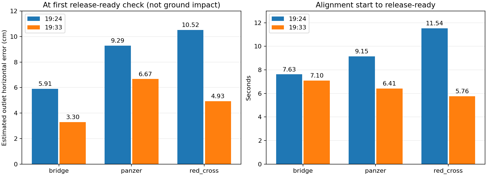

# 10月15日晚两轮逐槽投递比较

两份原bag完整解码，19:24为239.986秒/152561消息，19:33为244.277秒/134184消息。每轮均三次有效许可、原始服务调用与成功ACK，无DropTimeout触发日志。这里只分析软件位置估计，不将回执当作实际快递落点验收。

## 各次投递

以下误差采用控制器首次release_ready的原始值，时刻紧邻提交调用；FC误差为FC到补偿后的冻结FC目标，投口误差为按实时完整姿态旋转安装杆臂后的投口到冻结靶心。AGL来自起飞静止参考减22cm，不是独立测距真值。

| 轮次 | 仓位/类别 | FC误差cm | 投口误差cm | FC AGL m | 对准至释放就绪s |
|---|---|---:|---:|---:|---:|
|19:24|1后仓/bridge|5.44|5.91|0.4495|7.62|
|19:24|2右仓/red_cross|10.44|10.52|0.4474|11.54|
|19:24|3左仓/panzer|9.24|9.29|0.4449|9.15|
|19:33|1后仓/panzer|6.73|6.67|0.4488|6.41|
|19:33|2右仓/bridge|3.29|3.30|0.4495|7.10|
|19:33|3左仓/red_cross|4.98|4.93|0.4437|5.76|

## 补偿与释放条件

- 两轮H2D2：串行补偿，水平模式2、下降模式2，下降速度配置1.5m/s（不是实测速度）。目标AGL0.25m，允许释放区间0.10～0.45m。
- 后仓冻结FC目标相对靶心前移约12cm，右仓向左、左仓向右，并包含姿态旋转；记录不支持原来“同符号固定地图加12cm”的错误仍在发生。
- 下降前6cm标准靶/4cm红十字检查仍执行；最终release_ready全部显示release_xy_check=disabled，按高度放行。打印的末段XY参考容差不是启用的硬门槛，不能称本轮六次都在6/4cm内释放。
- 19:24下降前投口误差分别5.89、约4.00、5.73cm，释放就绪分别5.91、10.52、9.29cm；串行并未消除下降时的水平误差反弹。不能仅从这组曲线断定唯一原因是垂直刹车，尚需控制/位姿同步进一步辨别。
- 六次均在约0.44～0.45m首次放行，未等到0.25m目标，也未依靠20秒兜底。这符合本轮高度窗口逻辑。

## 时序及机构影响

19:24三投冻结至下降1.16/5.21/1.50秒，下降至提交2.24/2.24/2.56秒；19:33为1.35/2.70/2.15秒、下降至就绪2.50/2.50/2.65秒。较慢的19:24红十字主要多花在下降前水平补偿，而非下降后等待许可。

原始调用到ACK约1.0秒；19:33恢复通知发生在调用后约0.55秒，比ACK早约0.51～0.54秒。ACK附近FC已回升到0.57～0.60m。因此要评估真实投递落点，必须区分调用、机构真实松脱和ACK时间，不能只把ACK位置当作载荷释放点。此处仅记录现有行为，未修改恢复延时。

## 完整分析文件

- `试飞产物/1015-1924_drop_analysis/`：REPORT.txt、drop_summary.csv/json、drop_stage_events、drop_motion_samples及原板端归档。
- `试飞产物/flight_20261015_1933_analysis/`：REPORT.txt、drop_summary.csv、drop_analysis.json、drop_events.csv、drop_telemetry.csv、permission_transitions.csv。

无同步外部落点真值、实物松脱传感或ULog。本次未渲染完整视频，未重新执行视觉模型；未修改投递逻辑。
