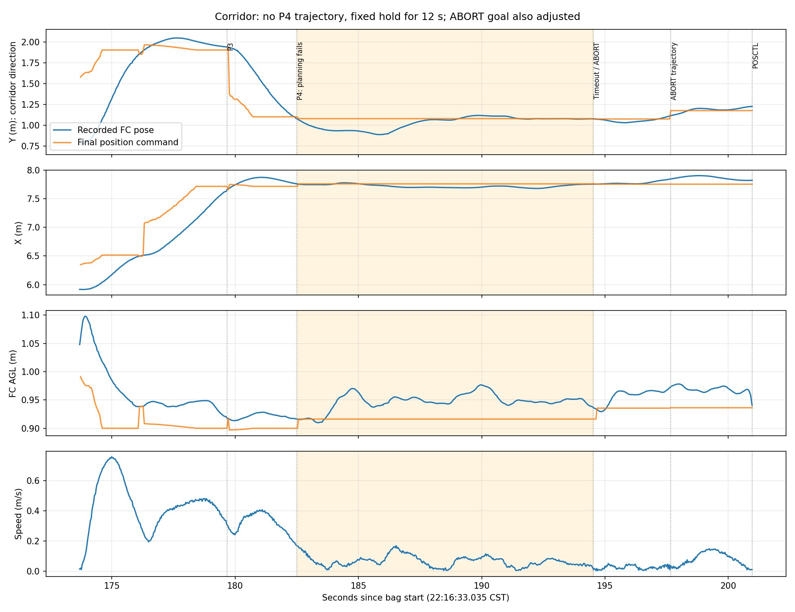
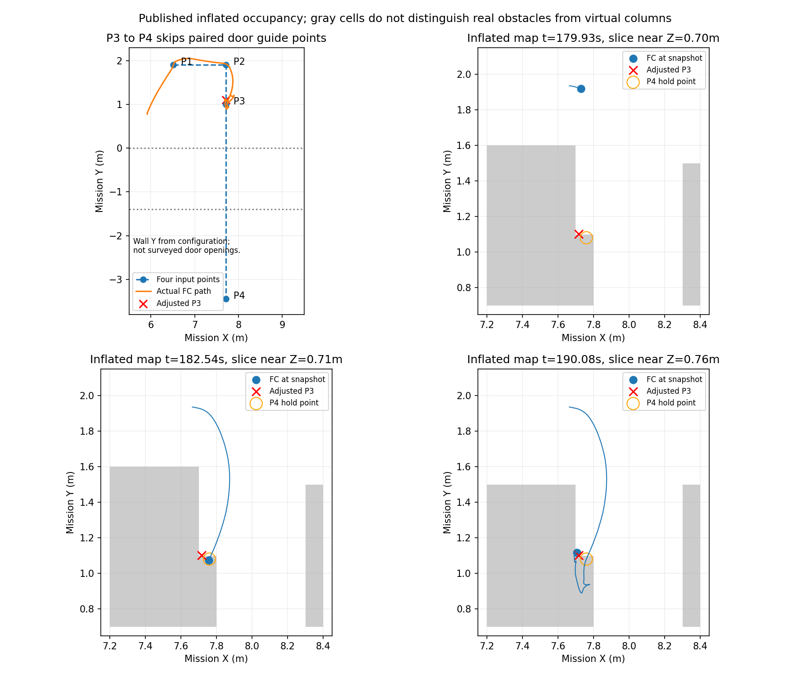

# 1013 22:16 实飞：走廊停滞分析

结论：三槽已有软件执行成功回执；走廊第三点完成后，下一段连续16次规划失败，约12秒没有可用轨迹，任务先进入ABORT，随后飞手接管。15次初始搜索记录起点占用，另一次起点为空后仍因两条拟合曲线的净空检查失败而无法继续。不能将本轮简单归结为任务没派点、雷达断流或H对准失败。

本轮输入仅四个走廊点，两道门成对的门前/门后短航段已不在输入配置中。导航恢复可能改善起点落入额外膨胀或虚拟柱时的困境，但不能保证后续穿门轨迹可行。另发现ABORT保位目标也被普通邻域调整，导致终态后仍有水平目标改变。

## 1. 数据及回放

- 原始文件：`试飞产物/1013-2216-投递H2D2-H降落vhD2.bag`，278,704,678字节。
- 录包：2026-10-13 22:16:33.035 CST起，213.650秒。下文时间均相对bag开始，非起飞时刻。
- [本地播放器](../../../试飞产物/analysis_1013_2216/replay/index.html)：完整原相机、标注相机、轨迹、综合看板四路各213.70秒、2137帧、10fps，完整解码校验通过。
- [走廊180–202秒切片](../../../试飞产物/analysis_1013_2216/replay/corridor_dashboard_180_202.mp4)及`replay/visual_frames/`关键帧。画面仍在变化，不能据下视图判断前方实体净空。
- [数值摘要](metrics.json)、[运动图](corridor_motion.png)、[膨胀地图图](corridor_map.png)。原始数值提取在`试飞产物/analysis_1013_2216/numeric/`。
- 包含`occupancy_inflate`，没有原始`/freedom/static_pointcloud`及占用来源分层。不能从膨胀点反推出实墙表面或断言全部都是虚拟障碍；本次也无ULog。
- bag中`map→camera_init`为静态单位变换。任务坐标起飞参考XY为`(0.016047,0.002763)`；地面Z为`-0.210970`，AGL=local Z−ground Z。

## 2. 四个点从何而来

metadata的**输入settings**就包含下面四点；随后实际派发也与之相符，并非录包只恰好看到优化后的四点。

| 输入次序 | 相对起飞参考X/Y | FC AGL | 本轮作用 |
| --- | --- | --- | --- |
| 1 | 6.5 / 1.9m | 0.9m | 入口外引导 |
| 2 | 7.7 / 1.9m | 0.9m | 进入走廊 |
| 3 | 7.7 / 1.0m | 0.9m | 第一门前方向的点 |
| 4 | 7.7 / −3.45m | 0.9m | 两门之后、H区前的末点 |

配置墙轴为Y，墙面位置为0和−1.4m；第三至第四点跨度4.45m，中间没有两道门各自成对的引导短段。四个输入点加后续H转场/捕获点构成任务的6点投后路线；本轮只执行到第4/6点的规划失败，没有进入H视觉降落。

对照导航0928本地已同步的`e340976740b1`：该提交把`Y=-0.7/-1.1`合成`-0.9`，删除`-2.5`，**仍保留五个点**，前两个Y仍为2.1。它没有删除`-0.9`，也没有把2.1改成1.9。该五点配置中的`-0.9`按现有运动优化规则是两门共享的受保护锚点。

所以本轮四点来自运行输入的进一步差异；不能把它归因于运动优化自动删点，也不能仅用e340确定全部现场修改的来源或操作者。原bag部署清单仍写Oct8的`51f48fc5`，不能当成本次运行二进制的准确版本。metadata还有`ordinary_waypoint_dwell_enabled:false`，该设置在本地e340生成器中没有读取入口，更不能宣称现场代码与e340逐字相同。

## 3. 停在哪里，为什么停

| 相对时间 | 录包事实 |
| --- | --- |
| 172.216s | 第三槽收到执行成功回执；这是软件记录，不替代载荷落点观察 |
| 173.688s | 派发走廊第1/6点 |
| 176.223s | 派发第2/6点 |
| 179.672s | 派发第3/6点，任务坐标约(7.716,1.003,0.689) |
| 179.753s | 第三点因邻域调整，有效Y变为1.103，比请求点沿来路退10cm |
| 182.155s / 182.393s | 规划器报告到达 / 任务侧记录到达 |
| 182.508s | 派发第4/6点，目标约(7.716,−3.447,0.689) |
| 182.538s起 | `start_occ=1 goal_occ=0`，初始候选全部被碰撞/关闭集合条件淘汰 |
| 190.240s | 一次`start_occ=0`；随后有搜索结果，但两条拟合轨迹仍未通过净空检查 |
| 194.527s | 从未获得第4点的有效轨迹，`initial_plan_timeout` |
| 194.575s | `ABORT / return_home_failed` |
| 200.961s | 首次记录POSCTL；MAVROS状态约1Hz，不能把采样时间当成拨杆的精确时刻 |

16次尝试中，15次初始搜索报告起点占用。190.487s的异常则是：

```text
both fitted curves violate clearance:
optimized=(8.242,0.203,0.749), initial=(8.241,0.285,0.771)
```

因此，即使暂时出了起点占用格，前方整段曲线仍可能不通过。不能承诺单纯延长12秒等待、提高速度或打开恢复即可通行。

新目标到来后，轨迹服务器打断旧轨迹并保存当前位置。182.54–194.52秒，**最终发给执行链的任务位置只有一组固定值**：`(7.759820,1.080442,0.705326)`。飞机没有收到向H区继续推进的新轨迹。

第三点切换时水平速度约0.169m/s。固定保持期间，实际Y先向前到0.889m，再返回1.119m，摆动跨度约23cm；相对保持点最远向前约19cm。指令并未随这段摆动改变，不能将这一段写成规划器主动倒飞，也不能凭bag断言已撞门。



## 4. 地图与到点衔接

182.535s膨胀点云中，飞机中心约`(7.757,1.074,0.705)`，对应附近占用体素中心为`(7.750,1.050,0.739)`；各轴差均在0.1m体素的半宽以内，与规划器同期`start_occ=1`一致。179.928s已可见相同占用格，本次并非只有等待期间才突然生成这个格。

第三点经调整后接近占用边界，实际到达点和跟踪偏差不能保证留在同一自由格。以当前0928源码作机制解释：普通点白名单使用12cm三维到达容差、0.3秒有效样本跨度、不检查速度；RETURN_HOME仍相对原请求点判到达。这个机制允许带速度换点，但本轮完整运行源码不在bag中，不能把上述默认值全部当成现场已验证参数。本轮确定事实是：切换时仍有0.169m/s水平速度，下一段起点在占用格中。



灰区是发布的膨胀占用，包含不同来源，**不是实墙外形**。图中墙面Y来自配置而非现场测量；本轮不能据此重新给出可靠门洞中心坐标。

## 5. ABORT仍会改变位置目标

194.575s ABORT后，桥接器以当前位姿生成普通规划目标：

```text
请求  (7.754837, 1.076782, 0.725381)
有效  (7.754837, 1.176782, 0.725381)  # Y增加0.10m，沿来路方向
```

197.653s该目标获得新轨迹，最终位置指令也确实变为调整后的坐标；200.008s规划器报告到达。**这不是原走廊任务恢复，任务仍为ABORT。**

当前源码解释了这条路径：ABORT被桥接成普通PoseStamped目标，规划器不知道它是“终止后保位”，仍允许邻域调整；旧控制器没有收到对应ABORT模式命令，继续消费Run_point下的规划输出。

这是一处独立的软件语义问题：如果ABORT意图是保持，就不应未经明确恢复安排又移动保位目标。它应单独修复，不能作为本轮已成功自动脱困来记账。

## 6. 导航恢复能否有用

**有针对性，但不能从本bag证明启用即可成功。** 当前候选会在普通规划前对占用起点或软件超高起点尝试短程恢复；成功后重新规划原目标，保持原任务期限。

| 起点占用来源 | 当前实现 |
| --- | --- |
| 纯虚拟延长柱COLUMN | 有实体净空时可尝试退出 |
| 额外普通膨胀BUFFER | 未侵入必要机体净空时可尝试退出 |
| 实体及必要机体膨胀PHYSICAL | 不放宽，起点和制动段也必须通过 |
| 边界、未知来源、地图未覆盖 | 不允许凭空退出 |

默认搜索半径0.8m、速度0.30m/s、加速度0.5m/s²、最长8秒，每个目标通常一次；位姿/地图年龄上限0.25/0.5秒。必要净空按XY 0.39m、上下0.20m重建，并额外检查0.08m跟踪误差范围。这里是已有导航恢复候选的规则，与已删除的投递下降点云门槛无关。

**当前08配置生成器调用`recovery_parameters({}, ground)`明确关闭恢复；仅向settings写enabled=true仍会被覆盖。** 如要验证，需先接好08入口到规划器、轨迹服务器和控制端的整套配置，不是随手改一个开关。

这份bag没有恢复所需的原始地图及来源分层，无法可靠重建PHYSICAL/COLUMN/BUFFER。即使有合法退出点，190.487s暴露的整段曲线净空问题仍须解决。恢复也不自动修复ABORT普通目标被调整的问题。

## 7. 排除项和处理顺序

173.68–200.96s走廊区间：LIO输出年龄P95约64ms、最大94ms，诊断雷达队列始终0；最终MAVROS位置指令接收间隔P95约63ms、最大85ms。数据不支持把这次12秒停滞解释为LIO积压、设定点断流或等舵机回执。高度保持约0.91–0.98m AGL，未见本段超高拒绝。三槽之后尚未走到H阶段，文件名中的H模式不等于本轮已验证H降落。

建议后续按以下顺序处理，本次仅分析，未改动飞行逻辑或板端：

1. 根据实测门洞恢复必要门前/门后锚点，保留运动优化对门点的保护。不要把这四点路线当成仍有逐门约束的路线；也不要盲目恢复旧坐标而忽略门洞移动。
2. 接续点应有足够净空，任务的到点容差、规划目标邻域调整与实际跟踪误差共同考虑。只把目标放到一个刚好空的体素边缘，不保证下一次能起步；无须因此把全场所有点改为严格停稳。
3. 单独修复ABORT保位语义。终止后若需要脱困，应显式经过恢复流程，不能继续作为普通可调整目标执行。
4. 接通08恢复开关后，针对额外膨胀/虚拟柱做定向动态验证，并录制原始静态点云或占用来源诊断。验证实际退出并继续原航点，不能只检查没有ABORT。

与前一轮(8)的对照：上一轮明确存在目标占用；本轮主要是新段起点占用，并叠加完整曲线净空失败。两者都最终受首规划12秒超时约束，但不应套用同一个单一原因。

## 8. 代码参照及复现

源码只读参照：导航仓`liftrace_board_trial_20260928`，`e340976740b1`。未fetch、未更改导航分支或板端。关键位置：

- `deployment/board_trials_4x4/08_full_mission/site_20261007_221730.yaml`：五点配置及e340的点位修改。
- `deployment/board_trials_4x4/common/uav_board_trials/scripts/trial_config.py:302–350`：到达参数、恢复关闭、普通点白名单。
- `patrol_uav_ws-patrol_planner/src/uav_mission/src/uav_mission/planner_execution.py:559/1058`：首规划超时、到点规则。
- `.../uav_mission/scripts/navigation_planner_bridge.py:511/1252`：ABORT当前点及恢复context撤销。
- `.../Fast-Planner/fast_planner/plan_manage/src/traj_server.cpp:244/337`：保持及新轨迹解除。
- `.../plan_manage/src/kino_replan_fsm.cpp:489/550`：邻域调整及恢复调用。
- `.../plan_manage/src/planner_manager.cpp:263`：优化/初始曲线的完整净空检查。
- `.../uav_mission/src/uav_mission/navigation_recovery_config.py`、`.../plan_manage/include/plan_manage/navigation_recovery.h`：恢复参数及全路径验证。

离线分析仅调用ROSbag读取和replay工具，没有启动ROS主节点、Gazebo、飞控或硬件节点。`extract_bag.py`使用Noetic系统Python读取bag，`analyze_corridor.py`使用已有rl_drone环境生成图表；不安装新依赖。

```bash
source /opt/ros/noetic/setup.bash
PYTHONPYCACHEPREFIX=/tmp/liftrace-bag2216-pycache /usr/bin/python3 docs/verification/flight_1013_2216_20261014/extract_bag.py   --bag '试飞产物/1013-2216-投递H2D2-H降落vhD2.bag'   --out-dir '试飞产物/analysis_1013_2216/numeric'
source /home/xhj/miniconda3/etc/profile.d/conda.sh
conda activate rl_drone
python docs/verification/flight_1013_2216_20261014/analyze_corridor.py   --run-dir '试飞产物/analysis_1013_2216'   --out-dir docs/verification/flight_1013_2216_20261014
```

复现备注：本机默认Python缓存下，追加核验遇到ROS库内部读取异常；改用独立`PYTHONPYCACHEPREFIX`后，原bag完整提取23个话题及5组点云快照成功。未修复或重写原bag。
