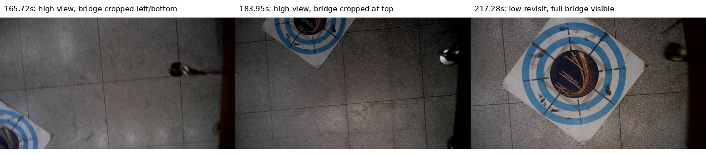
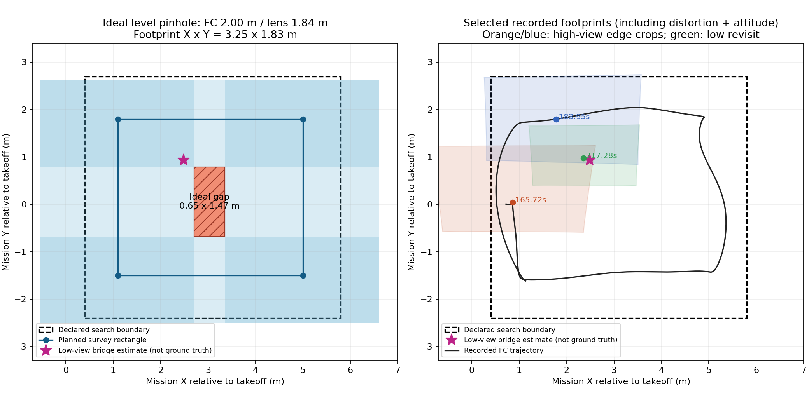

# 1014 04:25：bridge为何后期才形成正式坐标，矩形是否全覆盖

本轮早期已经有bridge粗线索及坐标；一直没有的是可用于低位复核/投递的圆环精定位目标。高空图像中的bridge基本贴着画面边缘，圆环关联未通过；另有短暂类别误判使该类处于冲突状态。扫完矩形后，任务利用保留的粗坐标低空重访，解除冲突并调用第二槽投递。并非后来无缘无故第一次找到bridge。

本报告仅分析既有bag，未改飞行代码、航点、高度、阈值或板端配置。全部时间均相对bag开始（2026-10-14 04:25:22.167 CST），不是相对起飞。数据来源、播放器和H问题见[原报告](REPORT.md)。

## 1. 分清三种坐标及实际时序

| bag时间 | 本轮实际记录 | 含义 |
| --- | --- | --- |
| 164.45s | YOLO首次bridge，置信度0.661，框在左下边缘 | 识别到了局部图案，但还不是合格HINT |
| **164.57s** | bridge HINT置信度0.811，地图坐标约 **(2.435,0.841)**，`bbox_navigation_only`、`geometry_verified=false` | 已经有可用于重访的粗位置，不是精确靶心 |
| 165.81–165.83s | 同一处裁切靶图案短暂被识为panzer，置信度0.838；bridge/panzer进入导航线索冲突 | 不是HINT门槛太高；这个误判本身超过0.75 |
| 170.44s | 真panzer的后续证据解除panzer冲突 | bridge仍处于冲突状态 |
| 176.76s | 靠近后来red_cross位置的一条裁切观测又被识为bridge，置信度0.800 | 进一步说明bridge高位线索存在类别/位置歧义；不是只有一次低分漏检 |
| 189.43s事件／190.26s派令 | 矩形完成，开始下降；此前有效panzer、red_cross已有，bridge仍冲突 | 没有满足三类无冲突线索提前退出条件 |
| 212.17s事件／**213.42s派令** | 首槽之后执行`SUPPORTED_CONFLICT_REVISIT`，飞向旧bridge粗位置 **(2.354,0.932)** | 明确是低空复核，不凭有冲突的HINT授权释放 |
| **216.12s** | 第一条bridge `circle_geometry`且`map_valid=true`，约(2.401,1.006)，置信度0.889 | 首次有通过几何检查的地图靶心；216.13s才进入`/uav_vision/targets` |
| **218.47s** | 低空复核完成，解除bridge冲突；复核位置约(2.479,0.926) | 同一类别终于成为可执行投递对象 |
| 218.54s／225.34s | 派出bridge对准动作／调用第二槽释放 | 后续进入正常投递流程；软件调用不单独证明实物落点 |

上述粗位置、记忆融合位置和末段冻结靶心用途不同，不能拿它们之间的差直接当作实物落点误差。坐标表为本轮`camera_init`地图坐标；与起飞相对XY仅差约(−0.00455,−0.00612)m。

回放地图面板没有绘制`/uav_vision/navigation_hints`，它从`/uav_vision/targets`选取`map_valid`目标。因而“面板没显示bridge坐标”与“任务没保存bridge粗位置”不是一回事。实现见`tools/bag_replay/bag_replay.py`的TOPICS及target history更新；本次未改变播放器。

## 2. 高空为什么没形成精定位目标

160–190.3s检查到75条bridge精修结果，**75条均为`circle_association_missing`，没有有效地图靶心**。其中74条类别ROI触及图像边界（容差2px）。这个统计不是模型召回率，也不要求所有裁切都必然拒绝；它说明本轮类别框存在时，圆环定位仍没有通过。

直接查看原始相机图像：



- 165.72s：bridge在左下边缘，仅部分板面入镜。
- 183.95s：回到矩形另一边时，bridge贴着上边缘，外环仍裁切。
- 217.28s：低空飞到已有线索附近，板面在画面内，随后形成连续几何观测与低空确认。

所以降低高度并没有扩大FOV。后来能找准，是飞机横向飞到了靶标上方，改善了取景位置和类别证据。

## 3. FOV有没有变化

本bag的8263条CameraInfo具有同一组尺寸、K、D：1280×720，fx≈725.351、fy≈723.340、cx≈631.672、cy≈397.566。与1007晚间成功轮及1008两轮保存的CameraInfo一致。没有发现本轮中途变焦、图像尺寸或内参变化。

本轮metadata高位为 **FC AGL2.0m**。实际静态TF是FC参考→IMU +0.05m、IMU→镜头−0.21m，镜头净偏移−0.16m，水平时镜头AGL约 **1.84m**。不是旧正赛候选2.76/2.16m，也不是另一份模板的2.6m。

按水平、零航向、平地针孔模型，地面视场沿任务X/Y约 **3.247×1.832m**。这是由内参推算的图像覆盖范围，**不是现场尺量的实际FOV**；本轮没有独立验证这套标定与当前镜头/采集设置的物理一致性。它也不是保证整个1m靶板可完整识别的中心区域；边缘处只露出部分靶板时，可以有类别HINT，却没有可靠圆环精定位。

历史核对来源：

- `试飞产物/board_full_mission_20261007_221730/camera_info.json`、`run_metadata.json`。
- `试飞产物/board_full_mission_20261008_223632/`及`board_full_mission_20261008_231313/`下同名文件。
- 三轮metadata均为高位2.0m及下列同一矩形；`known_rig`安装参数与本轮TF一致。历史三轮TF消息未重新逐条提取，结论限于归档安装配置。
- `7bd8393f`引入1007晚间内收航线；`deployment/competition/field_20261007_validated.yaml`注明取自该成功轮实际settings。metadata的部署来源revision不能替代所有运行源码版本判断。

## 4. 按现在航点，是否应当全覆盖

**当前2.0m试飞高度下，不能说这条矩形严格全覆盖。**

搜索区为X=[0.4,5.8]、Y=[−2.4,2.7]；实际配置高位路线：

```text
(1.1,−1.5) → (5.0,−1.5) → (5.0,1.8) → (1.1,1.8) → 闭合
```

矩形两条纵边相距3.9m，横边相距3.3m。上述理想视场分别只有3.247m和1.832m，四边连续飞行的覆盖并集仍留下中央约 **0.653×1.468m** 的空隙；范围约X=[2.702,3.355]、Y=[−0.680,0.789]。上方搜索边缘也未完全包含在这一水平模型内。因此“闭合一圈”并不等于“整个内部都看过”。



左图为水平、零航向、针孔模型，没有把它写成实际漏扫面积；右图使用本轮图像时刻插值TF、去畸变和地面求交，展示两次高位裁切与低位重访的视场。实际姿态、跟踪轨迹、遮挡会改变覆盖，未作全程实物可见性重建。星号为低空复核估计位置，不是测量真值。

**bridge不在左图中央空隙内**，本轮更直接的问题是两次高空经过均位于视场边缘、靶板不完整及类别冲突。不能把中央空隙当成此次bridge晚确认的唯一原因。

进一步说，即使理想FOV并集达到100%，也只表示地面点进过视场；没有保证整张靶板完整入镜、停留时间充分、无遮挡或类别不混淆。若原先按更高镜头高度算过覆盖，降低高度后必须重新计算，不能只保留原来的“全覆盖”结论。

## 5. 改进方向与本轮边界

1. 用实际镜头高度和相机标定重新计算扫描线间距，并为靶板完整入镜留重叠；矩形不够时再比较两线/三线，不能仅换路线名称就认为覆盖达标。
2. 保留粗HINT引导低空复核，本轮已经发挥作用；不要为了让面板早些出现坐标，把无圆环验证的框中心冒充精确靶心。
3. 本轮错误panzer HINT置信度0.838，超过0.75；提高阈值不能保证解决裁切混淆，需要继续比较包含实际边缘裁切的模型样本。
4. 没有因此自动调整飞行配置。此次确认了路线覆盖假设与实际2.0m配置的差别，但尚未验证新航线或新高度的动态收益。

## 6. 离线复现

原报告的`extract_bag.py`生成基本数值话题；补充执行`extract_bridge.py --bag BAG --run-dir RUN`（Noetic系统Python，只读bag），随后在现有`rl_drone`执行`plot_bridge_fov.py --run-dir RUN --out-dir REPORT_DIR`。前者提取HINT/原始检测/正式目标/TF及三张相机图，后者输出视场图、原图对照及[数值摘要](bridge_metrics.json)。不启动ROS、仿真或任何实机节点。