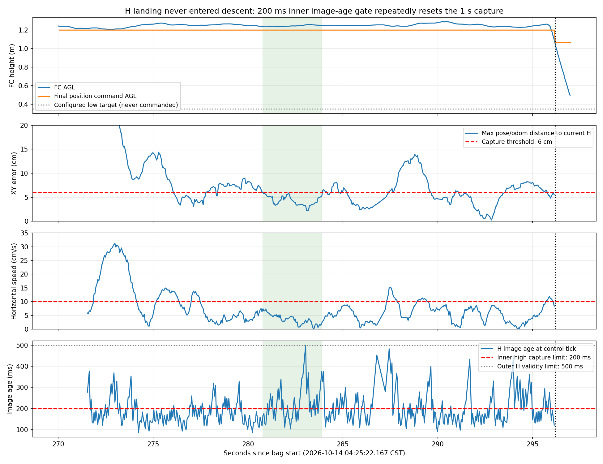
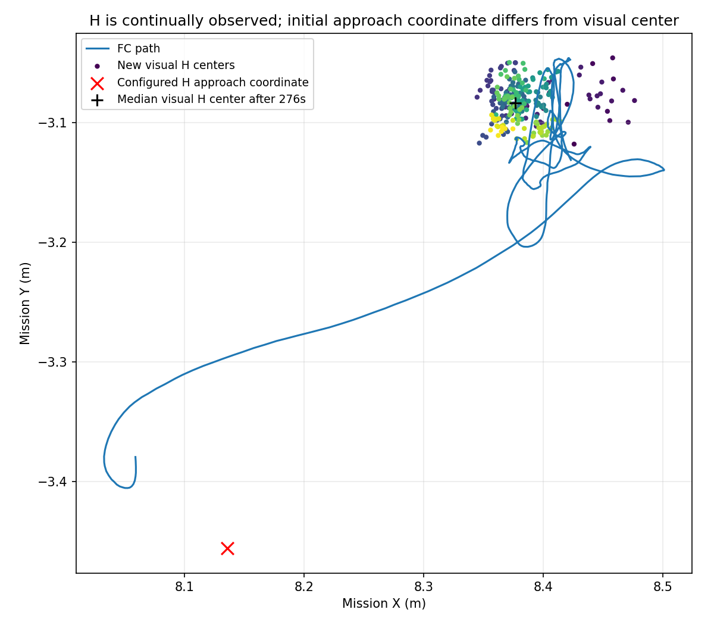

# 1014 04:25实飞：H高位确认阻塞与0928远端更新

本轮确实抵达H，但**没有进入自主下降**。LAND接受到POSCTL首次记录之间约24.97秒，控制器持续给FC AGL 1.20m目标，等待`vh`高位确认。H持续检出，位置和速度也有超过1秒的合格区间；主要阻塞是高位计时器硬编码的200ms观测年龄/间隔限制，反复清空1秒确认窗口。外层H有效期却为500ms，因此日志`valid=1`不代表内部计时门槛已通过。

0928远端已更新至`2adc69bf9ae7`，比本地`e340976740b1`多29个可达提交（包含合并及并入历史），但上述H高位计时类没有变化。本次仅fetch、离线分析和原类回算；未快进工作树、未改飞行代码、未上板、未启动仿真或硬件节点。

## 1. 原始资料和回放

- 文件：`试飞产物/1014-0425-投递H2D2-H降落vhD2.bag`，317,626,937字节。
- 开始：2026-10-14 04:25:22.167 CST，epoch 1791923122.167234；时长308.621566秒。下文时间均相对bag开始。
- [本地四路播放器](../../../试飞产物/analysis_1014_0425/replay/index.html)：CPU、10fps，四路各3087帧、308.7秒，完整解码通过。
- [H段综合回放](../../../试飞产物/analysis_1014_0425/replay/h_observation/dashboard_H_271_296_3.mp4)、[H原相机短片](../../../试飞产物/analysis_1014_0425/replay/h_observation/camera_raw_H_271_296_3.mp4)、[图像观察记录](../../../试飞产物/analysis_1014_0425/replay/H_OBSERVATION.md)。H初期下缘略裁切，约273秒起黑环和内部笔画完整可见，持续至接管附近，仍有画面内位置摆动。
- [量化结果](metrics.json)、[门槛时序图](h_handoff_gates.png)、[H地图坐标图](h_target_path.png)；完整31话题数值提取在`试飞产物/analysis_1014_0425/numeric/`。未发现本轮配套ULog。

## 2. 实际使用的H模式

以bag的`run_metadata.settings`、控制日志、最终输出交叉核对，不仅凭文件名或旧部署清单。

| 项目 | 本轮实际设置/行为 |
| --- | --- |
| 对准 | `landing_alignment_mode: vh`，高位连续确认后锁定H |
| 下降 | `landing_descent_mode: 2`，冻结H的XY，逐步降低Z位置目标 |
| 下降目标变化速率 | `landing_descent_speed_mps: 1.0`，是Z设定值递减速度，不等于实测下降速度 |
| 完成方式 | `landing_handoff_mode: POSCTL`，不是AUTO.LAND，也不是mode4 OFFBOARD触地方案 |
| H转场 / 捕获高度 | FC AGL 1.0 / 1.2m |
| 配置H中心 | 相对起飞点(8.14, −3.45)m |
| 下降终点 / 允许交接上限 | FC AGL 0.35 / 0.40m |
| 低位交接几何 | XY≤5cm，目标高度误差≤5cm；结合上限，本轮高度范围0.30–0.40m |
| 低位交接运动条件 | 水平速度≤0.10m/s，连续0.15秒、至少3个新odom样本；兼容字段`max_vertical_speed_mps`不参与此交接判定 |
| 本轮是否到达上述低位阶段 | **没有**；高位确认未完成 |

`landing_posctl.stable_duration_sec: 0.15`只管低位交接，无法调整高位硬编码1秒。降低0.35m终点或提高下降速度，都不会解除本轮高位阻塞。

术语对照：`non_vh`（旧`low`）是原先约10个新鲜合格H帧捕获；`vh`（旧`high`）使用6cm、0.1m/s、1秒确认。它们与下降模式1/2/3/4独立组合。mode1为原XYZ位置通道；mode2为冻结XY＋Z轨迹；mode3为零水平速度＋Z轨迹；mode4为冻结XY＋负VZ，保持OFFBOARD至真实触地确认并普通disarm，**不走POSCTL交接**。当前没有独立`v`或`H`对准枚举。

## 3. H阶段实际发生了什么

| 相对时间 | 事实 |
| --- | --- |
| 243.90s | 三槽后开始走廊；本轮输入仍是四点，但已改X=8.14、第三点Y=−0.7 |
| 263.49s | 走廊末点到达，随后执行H转场/升至捕获高度 |
| 271.191 / 271.205s | 任务派LAND / 控制器接受LAND |
| 271.531s | 开始接受新H地图标记 |
| 271.2–296.17s | 最终Z位置指令始终0.994073689，ground Z为−0.205926334，即FC AGL始终1.20m |
| 280.790–283.889s | 回算位置≤6cm且水平速度<0.1m/s连续约3.10秒，但观测时效使内部窗口多次重置 |
| 296.178s | 首次记录POSCTL；H控制器报`flight_controller_control_lost`，发布交接事件`CANCELLED` |
| 296.245s | 任务收到`landing_failed`并ABORT |
| 301.179s | 首次记录MANUAL未解锁 |

MAVROS状态约1Hz，因此模式记录不是遥控拨杆精确时刻。本轮只录到H交接`CANCELLED`，没有自身发出的`REQUESTED`或`OBSERVED`；POSCTL出现不能算本H链自动完成交接。该话题本来没有`READY`阶段，不能以不存在的字段诊断。

这与此前“已下降到低空却不交接”的现象不同。本轮高位目标没有冻结成功，持续消费新的H地图中心，尚未执行D2下降。最终模式变化之后高度下降，不能归功于H自主下降流程。

## 4. 为什么看起来对好了，还是不下降

`LandingHighAlignmentWindow`包含外层日志未完整展示的条件：

| 条件 | 不满足时的行为 |
| --- | --- |
| pose与odom到当前H的XY误差较大者≤6cm | 清零 |
| 水平速度严格<0.1m/s | 清零 |
| odom源时间、odom接收时间、H源时间、H接收时间均不超过200ms | 清零 |
| 四个时间不倒退、相邻间隔不超过200ms | 清零或重新起算 |
| 至少3个递增odom；当前时间及上述四个时钟跨度全部≥1秒 | 尚不足则继续等待 |

H新观测更新本身不直接清计数；但更新后的误差、年龄或时钟间隔可以让窗口重置。不能为了消除重置而给旧观测重新盖时间戳。

外层`externalLandingMarkFresh()`默认接受500ms内的H，`highLandingAlignmentReady()`日志中的`valid`来自这个外层条件。**所以会出现误差、速度、valid全部看起来合格，而内部仍不计时的情况。**

| bag时刻 | 日志水平误差 | 日志水平速度 | 对应图像年龄回算 | 仍被拒绝的原因 |
| --- | --- | --- | --- | --- |
| 281.594s | 3.72cm | 5.08cm/s | 294ms | H超过内部200ms |
| 283.644s | 3.93cm | 1.71cm/s | 268ms | 同上 |
| 285.695s | 3.30cm | 4.89cm/s | 271ms | 同上 |
| 286.741s | 3.48cm | 1.41cm/s | 403ms | H源时间/接收时间超限 |
| 292.898s | 0.91cm | 8.53cm/s | 280ms | 即使接近正中，仍因H年龄超限清零 |

这不是整个25秒都只被时效挡住：初始接近和其他时间也有XY或速度超限。关键是已经出现多个足够长的几何/速度合格窗口，却被额外时效条件打碎。

- H阶段253张独立图像的地图H观测均为`map_valid=true`；其中一个超过外层500ms的H被控制器拒绝，不能把地图有效直接当成控制器全收。
- 新观测到达地图投影输出时，年龄中位124ms、P95 241ms、最大525ms；控制周期继续使用上一张观测时，年龄还会增加。
- 匹配484个有H目标的控制样本：188次H年龄超过200ms；200次几何和速度均合格，其中75次仍遇H年龄超限。
- 几何/速度合格最长3.10秒；含内部基础时间限制后，最长连续段约0.80秒。



## 5. 原生产计时类离线对照

使用原`landing_high_alignment.h`，以同一bag重建的484个样本输入实际C++类：**零次通过**，与实飞未冻结/未下降一致。

敏感性对照只在临时目录修改H源/接收年龄和相邻H间隔上限为500ms；odom仍200ms，几何6cm、水平速度0.1m/s、持续1秒、至少3个新样本不变。该固定轨迹中首次可通过为**281.889s，即LAND接受后约10.68秒**。

这是“原轨迹上存在触发机会”的回算，不是重跑飞行；真正锁点后路径和后续图像会变化，不能宣称已经证明节省14秒、实际下降成功或落点精度达标。临时对照没有改变任何工程运行头文件或YAML。

方法边界：用最终控制目标匹配实际使用的地图H观测；odom/pose按此前录包接收样本，速度按odom四元数从child转至任务坐标。20条节流控制日志的误差和速度与回算吻合至打印精度（XY差P95约0.046mm）。bag接收时刻不等于控制器回调接收时刻，200ms附近或几毫秒未来值仍存在调度顺序不确定性；294/403ms等明显超限样本不依赖几毫秒误差。

## 6. H检测质量与粗导航点

约273秒后，回放黑环和内部笔画完整，H始终在视野内。276秒以后的地图H中心中位为任务坐标`(8.3766,−3.0836)`，相对该中位的径向离散P95约3.68cm、最大4.50cm。这是观测一致性统计，不是真值定位误差。

配置H进场点在任务坐标约`(8.1355,−3.4561)`，与视觉中心中位相距约44cm，造成最初需要额外水平接近；但它解释不了后面已经连续3.10秒几何/速度合格仍不下降。本轮优先修确认链中的时效不一致，不需要先重写H检测器。



## 7. 0928远端更新

已fetch `origin/liftrace_board_trial_20260928`。本地HEAD仍`e340976740b131b401460431e88123ba407fc158`；远端为`2adc69bf9ae7cc3b62cbd88f06ba61034c20f427`，本地独有0、远端独有29。未跟踪的`HANDOFF_JAMES.md`和`legacy_baseline/20261013/`保留；没有快进或覆盖本地工作树。

[完整新增提交列表](remote_changes.txt)。新增内容覆盖92个文件，既有当前板端工作，也有合并带入历史，不能把29条都说成今天新写的独立功能。

| 更新 | 对本次结论的影响 |
| --- | --- |
| 03独立H专项继承08的`landing_*`，保留自身H点；05低空多投增加走廊/H | 不同入口H模式更一致；高位时效问题也会影响使用同一vh路径的入口 |
| 03/08采用vh＋D2、H Z轨迹速度1.0m/s；D2允许上限提高至3.0m/s | 本轮仍实际1.0m/s，且未进入下降，提高上限不会解除高位卡点 |
| 普通航点停稳开关，四点路线及现场坐标更新 | 本轮metadata的`ordinary_waypoint_dwell_enabled:false`已有源码入口；不影响H高位确认条件 |
| 投递目标0.15m、窗口0.10–0.43m，调用后不等ACK即可恢复/续任务 | 与本轮投递记录相符；这是前线另行修改，不可继续宣称沿用0.40m目标/0.35–0.45m窗口 |
| new_video_v8 FP16模型、起飞Z领先默认关闭、ULog工具、environment `--extend`、舵机调试服务 | 其他板端更新；不能据H失败把它们全部判无效 |
| `landing_high_alignment.h` | **没有修复**；仍为200ms限制和1秒窗口 |

高位计时类引入提交为`9c1476d039ac`（2026-10-12 16:26:08，`feat: 增加H高位对准垂直下降模式并放宽低位交接`）。此处是10月6/7日验收之后的新行为，不应将旧H实飞成功结论直接用于当前vh确认路径。

源码定位（远端2adc69bf）：`patrol_control/include/patrol_control/landing_high_alignment.h:18`，`patrol_control/src/patrol_control.cpp:4344`；共同入口`application.launch:52`将motion odom接到`/navigation/local_odom`。高低阶段两份窗口分别使用独立实现，低位0.15秒不会覆盖高位1秒。

bag旧deployment清单不是本次二进制版本凭证。本轮settings、实际日志和新增`release_invocation`行为与最新链路一致，但仅据bag不能锁定板端构建恰好等于远端哪个完整commit。

## 8. 建议与交付边界

1. 优先统一H高位确认的图像时效与现有外层有效期，区分图像和odom的时效；保留源时间，不把重复图像算成新确认。先避免“外层有效、内层反复清零”的矛盾，不急于继续放宽水平精度。
2. 将高位时效/计时参数显式化，拒绝日志给出具体年龄或重置原因。否则`xy/speed/valid`三项全合格仍在等，现场无法看出卡点。
3. 保留成功锁点后固定H、按选定D2下降的原则。此次没有下降数据，低位交接和触地精度仍需新的动态验证；不能仅用敏感性回算宣称H整链通过。
4. 下次现场核对H粗导航坐标，减少最初44cm修正；不把本轮视觉中位直接当作下一场真实测量值。

本次新增报告、两张图、离线提取/回算脚本及摘要，运行代码和板端均未修改，尚未将远端实验性改动合并到其他分支。

## 9. 离线复现

`extract_bag.py --bag <bag> --out-dir <analysis/numeric>`用Noetic系统Python；其余Python用既有`rl_drone`。本机推荐独立`PYTHONPYCACHEPREFIX=/tmp/liftrace-bag1014-pycache`，避免前轮默认缓存异常。依次运行：

```text
extract_bag.py --bag BAG --out-dir RUN/numeric
reconstruct_gate.py --run-dir RUN
replay_gate.py --run-dir RUN --nav-repo NAV_REPO --revision 2adc69bf9ae7cc3b62cbd88f06ba61034c20f427
plot_h_landing.py --run-dir RUN --out-dir REPORT_DIR
```

`RUN`为`试飞产物/analysis_1014_0425`，保留其`bag_info.json`；`replay_gate.py`从指定Git版本取头文件，在临时目录编译对照，自动清理临时文件。运行原类与敏感性对照分别输出`h_gate_cpp_result.csv`、`h_gate_cpp_sensitivity.csv`。不启动ROS主节点、不发布话题、不调用模式切换/执行机构服务。


## 10. 为什么10月6/7日能落，后来却不能开始下降

2026-10-14补充：以下按源码提交、当日部署记录和10月7日原始control.yaml对照，区分捕获、下降、低位交接。没有修改运行代码。

### 已通过的旧流程

10月7日221730的归档`control.yaml`明确为10个新鲜H帧、XY≤8cm、H年龄≤0.5秒；捕获后冻结H，目标FC AGL0.40m，≤0.55m且XY≤8cm请求POSCTL，**没有独立速度/持续停稳窗口**。历史`fd1019ec`和`397d10d9`的externalLandingTick与此相符。实际约3秒锁定；交接高度约0.538m，距H观测中位3.9cm，2.2秒后触地时12.4cm。后续修改有明确的减小交接后偏移目的，但改变后的条件需独立验证。

10月6日部署记录也列同一组8cm/10帧/0.5秒及0.40/0.55m参数。控制补丁`fd1019ec`、灰度形态检测`f0ff8999`分别有上板记录，但未找到用户指定成功专项的完整版本归档；已保存160434是较早AUTO.LAND后接管轮，不能替代后来成功轮进行精确对照。这不否认现场确认的成功，仅说明不能给它编造完整运行commit。

来源：[10月6日部署参数](../../deployment/h_posctl_handoff_20261006/DEPLOYMENT.md)、[10月7日原配置](../../../试飞产物/board_full_mission_20261007_221730/control.yaml)、[10月7日时序及偏移](../flight_221730_20261008/REPORT.md)、[10月12日旧新条件对照](../h_landing_review_20261012/REPORT.md)。

### 关键变更，不把同步提交重复算成功能

| 日期/提交 | 修改 | 对运行的影响 |
| --- | --- | --- |
| 10月8日 `073c8f19`（视觉集成仓） | POSCTL目标0.35m、上限0.37m；XY5cm；新增运动与持续窗口，初版水平3cm/s、垂直5cm/s、0.5秒 | 为减少交接后漂移收紧条件；初版也把运动窗口接到高位捕获 |
| 10月8日 `5f117e18`、`33a521a8`、`87fb2726` | 先分离高位高度容差、并行计数，最终撤销高位运动窗口，恢复10帧捕获；低位改8cm/s、垂直10cm/s、0.15秒 | 初版并非一直保留；当日最终又恢复成熟的下降前流程，但低位交接已经不同于10月7日 |
| 10月12日 `9c1476d0`（导航0928） | 新增可选high（后更名vh）：XY6cm、速度<10cm/s连续1秒，图像和odom均200ms；同时低位放宽至上限0.40m、高度容差5cm、水平10cm/s，不再检查垂直速度 | 新的高位门槛正是本轮200ms/500ms不一致的来源；此时默认仍为low |
| 10月12日 `9d1f80ce`、`829d65bc` | 增加独立下降模式：D2冻结XY＋Z轨迹，D3零水平速度＋Z轨迹，D4 OFFBOARD触地 | 改的是捕获后的执行方式；D4未用于本轮，不能拿其行为解释此次H失败 |
| 10月13日 `9d52c410` | low/high更名non_vh/vh，08默认从low＋D1改为vh＋D2 | **从可选新能力变为本轮实际采用的默认路径**；不只是改名称 |
| 10月14日 `7bfa987f` | 03专项继承08的landing参数，保留自己的H点 | 专项也可能走新vh门槛，不能仅凭“03以前通过”沿用旧验收结论 |

本轮D2目标变化速率已由默认0.2调为1.0m/s；允许速度上限升到3.0不表示本轮实际使用3.0。它没有开始下降，故本次失败不能归因为D2下降刹车或低位POSCTL门槛。此前用户描述的“下降到低空后不交接”也不能与本轮混为一个原因；缺少那些轮次的相应日志就不能全部归因于高位200ms。

### 两处200ms限制该怎样理解

应去掉H图像额外套用的200ms硬限制，复用已存在的有界H时效（本轮500ms），与odom的200ms要求分开，而不是删除全部时效、倒序、重复帧检查。既有500ms敏感性对照保持6cm、10cm/s、1秒不变，在281.889秒给出通过机会；进一步核对该样本也伴随新的H源时间，不只是无新图像的中间控制周期。后续共有32个“计时类通过且H源时间推进”的回算样本。

这支持解除本轮已定位的高位阻塞，但不能直接宣布整条降落成功：之后仍有低位高度带、5cm、10cm/s及0.15秒交接要求，且本bag未执行该段。旧版的更高位置交接曾出现约9cm交接后位移，也不宜整套回滚。

若选择恢复旧捕获，现有`landing_alignment_mode: non_vh`仍保留十帧路径，可与D2独立组合；它不等于回到10月7日全部参数，低位新门槛仍存在。本次仅说明可用路径，未改默认模式或任何飞行参数。
