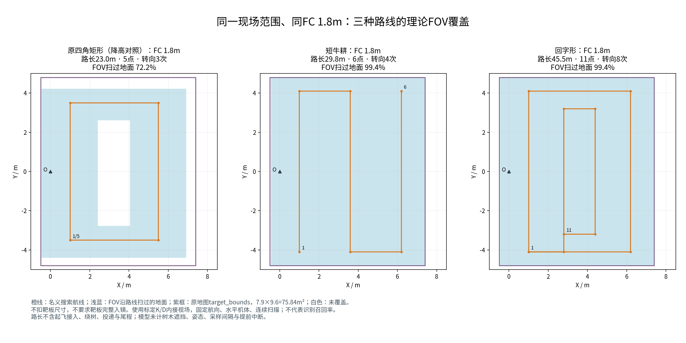

# 现场低位搜索备份、覆盖比较与高度等待（2026-10-15）

本轮基于导航0928远端 `af599680`，新增第10组低位整场备份，并将08原高位整场投递目标按用户要求调整为FC AGL 0.25m。只做本地实现、离线配置/回归和录包分析；未上板、未启动仿真或硬件。原现场地图只读，五个走廊点和H保留，不凭空补造门洞。

## 入口与参数

导航仓目录 `deployment/board_trials_4x4/10_low_coverage_full/`：`settings.yaml`为继承08的覆盖参数，`site_waypoint_map_20261015.yaml`为用户打点地图副本，`start.sh`为统一入口。

```bash
# 在更新后的0928工程根目录，仅离线展开，不启动节点
./deployment/board_trials_4x4/10_low_coverage_full/start.sh preview \
  --site-config "$PWD/deployment/board_trials_4x4/10_low_coverage_full/site_waypoint_map_20261015.yaml" \
  --coverage-agl 1.8 --coverage-pattern lawnmower --check-config
# 回字形：只将 lawnmower 换成 nested_rectangles；1.9m：只改 --coverage-agl 1.9。
# 正赛速度可另加 --speed-profile competition；默认limited为0.5m/s、0.35m/s²。
```

工作台“备用10”卡片提供牛耕/回字形、FC 1.8/1.9m。导入原waypoint_map.yaml后须“保存并用于本组”，再生成命令；改形状/高度会使旧命令失效。飞行入口前先核对同配置。默认mock，实投仍须显式选择，卡片不会自动解锁。

| 项目 | 本备份 |
|---|---|
| 搜索高度 | FC 1.8m，备选1.9m；镜头相应1.64/1.74m |
| 搜索路线 | 默认三线短牛耕；可选内外两圈回字形 |
| 正常速度档 | limited 0.5m/s、0.35m/s²；competition 1.2m/s、1.0m/s² |
| 导航前视 | 沿用1.0/0.6m调度，不等于实际飞行速度 |
| 软件限高 | 2.3m；额外虚拟顶棚关闭 |
| 避障 | 虚拟向上柱关闭；实体点云、常规膨胀、Fast-Planner保留 |
| 投递 | 继承08 H2/D2，目标0.25m，窗口0.10～0.43m |
| 投后恢复 | 原运动优化开启；0.9m及原反馈条件满足后可交给规划器边走边升 |
| H | 原地图H捕获0.9m；其余继承08 vh/D2/POSCTL，目标0.35m、交接上限0.50m |

**0.25m是目标，不是释放下限。** 08的`settings.yaml`与`competition_speed.yaml`也改为0.25m；未把整仓其他独立模板一律改写。原高位08的搜索方式、速度、原0.10～0.43m窗口保持。

正常低位链中bridge/panzer/red_cross任一确认可立即中断；不要求先凑齐高位三类HINT。直接复用原MissionRuntime，低值目标按原策略留待后续；投后保存并恢复未完成航点游标。三投且RECOVERY完成才进原走廊/H。不足三投且覆盖结束、无可选目标时仍按原逻辑返航，不伪装三投成功。恢复游标不等于保证把每一段中断遗漏的扫描补齐。

## 路线与覆盖

原地图coverage_bounds仍为X[0.4,6.8]、Y[-4.1,4.1]；跨扫描方向两端内收0.6m，牛耕间距2.6m，长线沿Y；回字形另用圈间内收1.8m。

- 牛耕：X=1.0、3.6、6.2，Y在-4.1与+4.1之间交替；6个端点、29.8m。用户明确只按FOV扫地面积比较，故从初稿72m/16点进一步缩短到三线，不为完整靶板入镜增加航线。
- 回字形：外框X[1.0,6.2]、Y[-4.1,4.1]，内框X[2.8,4.4]、Y[-3.2,3.2]；两圈间正交连接，共11点、45.5m。外圈优先，圈间内收与牛耕间距独立。
- 四边形：原map的(1,-3.5)→(5.5,-3.5)→(5.5,3.5)→(1,3.5)→闭合，23.0m。同高度对比只是几何回算，未另外增加1.8m四边形运行入口。

**本次最终口径：只计算FOV沿整条路线扫过的地面面积，不扣靶板尺寸，不加靶心/完整板入镜约束。** 分母为用户地图target_bounds：X[-0.5,7.4]、Y[-4.8,4.8]，7.9×9.6=75.84m²；coverage_bounds只是航点生成区，不是这个面积分母。不得把此值不加说明地换成口述场地尺寸。

| 路线 | FC 1.8m覆盖 | FC 1.9m覆盖 | 名义路长 |
|---|---:|---:|---:|
| 原四边形四角 | 54.76m² / 72.21% | 57.73m² / 76.12% | 23.0m |
| 三线短牛耕 | 75.40m² / 99.42% | 75.84m² / 100.00% | 29.8m |
| 回字形 | 75.40m² / 99.42% | 75.84m² / 100.00% | 45.5m |

参照：原四边形在FC **2.6m** 时覆盖73.04m² / **96.31%**。上面同高度表不把2.6m矩形和1.8m新路线混为同高度比较。

FOV仍由已有标定K/D推算：1.8/1.9/2.6m时镜头离地1.64/1.74/2.44m，内接视场约2.87×1.62、3.05×1.72、4.27×2.41m。前提为平地、水平机体、固定航向、连续飞完整路线；不代表树木遮挡、倾斜、离散图像和提前投递中断后的真实识别率。100%只是该平面模型扫过全部指定区域，白色缺口在图中如实保留。

按路长除速度：1.2m/s时四边形19.2s、牛耕24.8s、回字形37.9s；0.5m/s时46/59.6/91s。未含加减速、起飞接入、转角、避树、投递与尾程，不能作为完赛时间。当前三线牛耕以比原矩形多6.8m的路长，在低位取得接近全搜索区的理论FOV覆盖；回字形多15.7m且同口径覆盖相同，纯效率无优势，保留外圈优先的备选价值。



[PDF](route_comparison.pdf) · [同1.9m三路线](route_1p9.png) · [完整数值](route_comparison.json) · [可复现脚本](compare_routes.py)

## 15:02轮高度偏差为何拖住进度

本段来自1015-1501 bag，不能与新16:56轮混为同一事件。

| bag秒数 | 下发FC AGL | 实际反馈范围 | 反馈位姿变化推算平均Vz | FC上报平均Vz |
|---|---:|---:|---:|---:|
| 62～68 | 2.00m | 2.217～2.293m | -0.0009m/s | -0.237m/s |
| 70～78 | 2.00m | 2.163～2.245m | -0.0041m/s | -0.201m/s |
| 90～100 | 1.40m | 1.526～1.567m | -0.0016m/s | -0.147m/s |
| 112～117 | 1.40m | 1.398～1.435m | +0.0016m/s | -0.008m/s |

生成器普通到点误差为三维12cm。高度偏差自身大于12cm时，水平到点也不能完成；非position-only目标另受速度与0.8s驻留约束。高位首点约69.39s被替代点取代，约78.90s继续换目标；不是已到点后单纯没有回调。103.57s才记录该下降动作motion_arrival_confirmed。

外层任务持续给出较低目标，但实际FC反馈未收敛；现有停滞处理主要重规划/换点，不能替代飞控闭环把高度拉回。该轮额外顶棚已关、软件限高3.2m，故不是顶棚截断2m指令导致。位姿高度近乎静止而速度报告持续向下，提示反馈/估计一致性需要核查；无ULog，尚不能确认具体EKF、控制或外源原因。不能把这段偏差当固定静态偏置去统一下减20cm，也不能以扩大到点门槛修复估计本身。

[高度回算](height_review.json)；新16:56轮LIO积压、EV缺口、FC跳变另见[专项报告](../flight_1015_1656_lio_20261015/REPORT.md)。

## 验证与交付边界

配置生成、低位中断/恢复语义、工作台命令参数和入口校验已做定向回归；最终数量与提交见本轮变更记录。无新Gazebo、无实机飞行。1.9m搜索并不代表能够飞越1.9m树冠；真实树叶探测和绕行仍依赖原实体点云与规划链，待在定位健康时动态验证。


## 本地交付定位

- 导航0928候选提交：`2f0c932a`，基线`af599680`。新入口需要该完整适配提交，不能只复制10目录。
- 工作台前线新版及Windows/WSL同包：`/home/xhj/liftrace-deliverables/workbench_review_20261015/flight_workbench_20261015_low_coverage_shapes.zip`。源码工作台在本工作树`tools/flight_workbench`，前线UI版本在同交付目录`fixed/flight_workbench`。两者同接新卡片，保留各自现有界面。
- 默认速度仍为limited 0.5m/s、0.35m/s²；工作台新卡片未额外添加速度覆盖。若计划用正赛速度，导航CLI可显式`--speed-profile competition`，不应仅看前视1.0/0.6m便推定速度已提高。
- 导航89项相关测试＋4项resume CLI通过；工作台两份各8项新增测试，前线回归16通过/3依赖跳过，浏览器9场景通过，四组形状×高度生产CLI展开通过。所有结果均为离线/本机工具验证。
