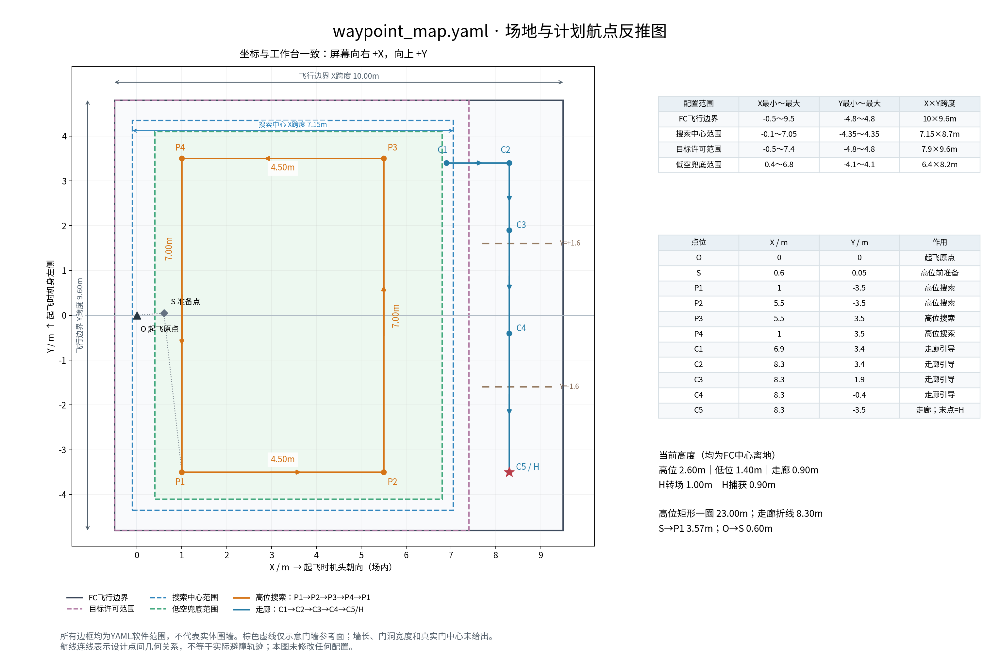
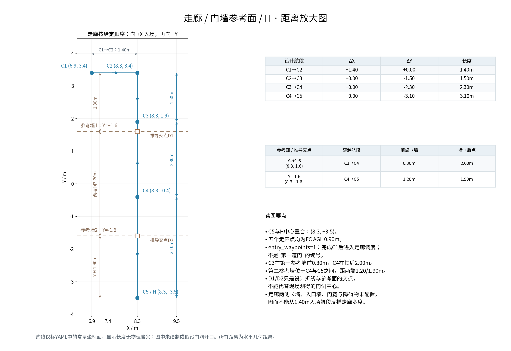
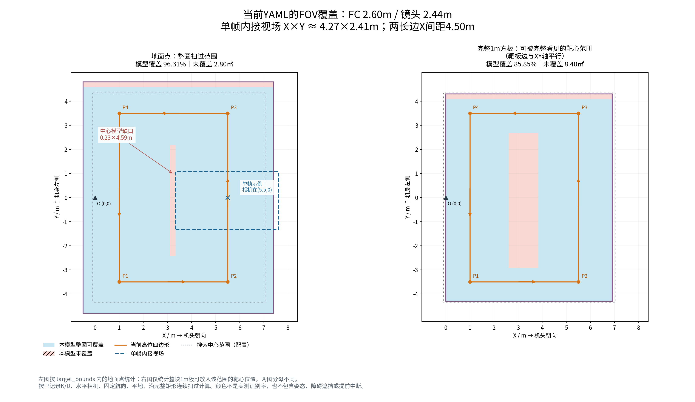

# 2026-10-15：waypoint_map.yaml 场地图、距离与FOV

输入为用户提供的`试飞产物/waypoint_map.yaml`。本目录保留[原样快照](waypoint_map.snapshot.yaml)，没有修改用户原文件或板端。图中坐标与工作台相同：**屏幕右为+X（起飞时机头朝向），上为+Y（起飞时机身左侧）**，起飞原点O=(0,0)。

[三页合并PDF：场地、走廊、FOV](field_plan_with_fov.pdf)

## 图件

- [全场坐标和距离图](waypoint_map_overview.png)，[矢量SVG](waypoint_map_overview.svg)
- [走廊放大图](corridor_detail.png)，[矢量SVG](corridor_detail.svg)
- [FOV整圈覆盖图](fov_coverage.png)，[矢量SVG](fov_coverage.svg)
- [场地与走廊两页PDF](waypoint_map_diagrams.pdf)，[FOV PDF](fov_coverage.pdf)

## 配置范围与实体场地不能混同

| 范围 | X范围 | Y范围 | X×Y跨度 | 面积 |
| --- | --- | --- | --- | --- |
| flight_bounds，FC飞行边界 | −0.5～9.5 | −4.8～4.8 | 10×9.6m | 96㎡ |
| search_center_bounds，搜索中心范围 | −0.1～7.05 | −4.35～4.35 | 7.15×8.7m | 62.205㎡ |
| target_bounds，目标许可范围 | −0.5～7.4 | −4.8～4.8 | 7.9×9.6m | 75.84㎡ |
| coverage_bounds，低空兜底范围 | 0.4～6.8 | −4.1～4.1 | 6.4×8.2m | 52.48㎡ |

**绿色虚线是低空兜底范围**，不是相机FOV或实体墙。任务仍缺目标并进入低空覆盖补搜时，在这个范围内生成航线。橙色是现有高位四边形。

用户口述实体搜索区约X7.2×Y9.7m；本YAML中的搜索中心、目标许可范围各有用途，数值并不相同。仅凭这些软件框，不能断言实体场地尺寸变化或将框线当成围墙。

## 航点与距离

S准备点=(0.6,0.05)，离起飞点直线约0.602m。高位顺序为P1=(1,−3.5) → P2=(5.5,−3.5) → P3=(5.5,3.5) → P4=(1,3.5) → P1；矩形边长4.5/7m，闭合总长23m。S到P1几何距离3.572m。

走廊：C1=(6.9,3.4) → C2=(8.3,3.4) → C3=(8.3,1.9) → C4=(8.3,−0.4) → C5/H=(8.3,−3.5)。各段长度依次1.4、1.5、2.3、3.1m，合计8.3m。以上不含实际绕障、停留及三投期间运动；不能直接相加当成整场飞行距离。

`axis=1`表示Y常量门墙参考面，按前进次序为Y=+1.6、Y=−1.6，两者相距3.2m。设计航线与它们相交于(8.3,+1.6)、(8.3,−1.6)，**这只是推导交点，不是已测门洞中心**。

- 第一参考面位于C3→C4段：C3距墙0.30m、C4距墙2.00m。
- 第二参考面位于C4→C5段：两端距墙1.20m、1.90m。
- `entry_waypoints=1`表示完成C1后进入走廊调度，不是门编号。
- YAML没有入口墙、两侧长墙、门洞宽度和实际开口中心。图中虚线显示长度无物理含义；C1→C2长1.4m不能用作走廊实测宽度。

当前高度均指FC中心：高位2.6m、低位1.4m、走廊各点0.9m、H转场1.0m、H捕获0.9m。**尚未采用刚才讨论的2.76m和新内收矩形。** 此文件也不含完整速度、投递、H末段交接或模式配置，不能当作一份完整启动配置。

## FOV怎么算、图里补了什么

**按内参推算，不是实际飞行覆盖统计。** K/D及安装关系来自1014实飞记录；位置采用本YAML设计航线，高度为FC2.6m，镜头净偏移−0.16m，因此镜头2.44m。按水平下视、固定名义航向、平地，将图像边缘去畸变、投影至地面，使用数值内接矩形约4.271×2.409m。沿各条直线连续移动所得矩形集合求并集，再与指定范围相交计算面积。

- 蓝色为整圈模型覆盖；蓝色虚框为相机在(5.5,0)时的单帧示例；粉色为该模型未覆盖区域。
- 左图分母是`target_bounds`，75.84㎡；模型覆盖73.041㎡，96.31%。中央约X=[3.108,3.337]、Y=[−2.421,2.170]留0.229×4.591m的模型缺口，另外目标范围顶部还有未覆盖条带。
- 如果只统计较小的`search_center_bounds`，点覆盖为98.31%，未覆盖约1.052㎡。这不是左图96.31%的同一分母。
- 右图考虑整块轴对齐1m方板必须同时入镜；其可放置靶心区域先由目标范围内收0.5m，分母59.34㎡，模型覆盖85.85%。它不是YOLO召回率，不能与左图直接相减解释。
- 实际靶板旋转、飞机倾斜/偏航、避障偏离、障碍遮挡、图像延迟/模糊、提前中断均未纳入。当前图也没有用bag真实位姿扫描轨迹；“内参来自实飞”不等于“覆盖已经实飞验证”。

两条长边相距4.5m，而当前内接视场宽约4.27m，因而现有矩形不能宣称严格全覆盖。完整1m板取景比地面点覆盖要求更高。本轮只绘图和分析，不自动改高度或点位。

## 复现

使用现有rl_drone环境运行`render.py --input <yaml> --output <目录>`和`render_fov.py --map <yaml> --calibration-result ../competition_video_20261015/fov_metrics.json --output <目录>`。字段解释核对了生产`competition_config.py`、`corridor_speed.py`与工作台`WAYPOINT_EDITOR.md`。脚本保留原YAML字节快照，输出前后确认输入未变；图件已人工检查标签与距离。[几何数值](metrics.json)、[FOV数值](fov_coverage_metrics.json)。
